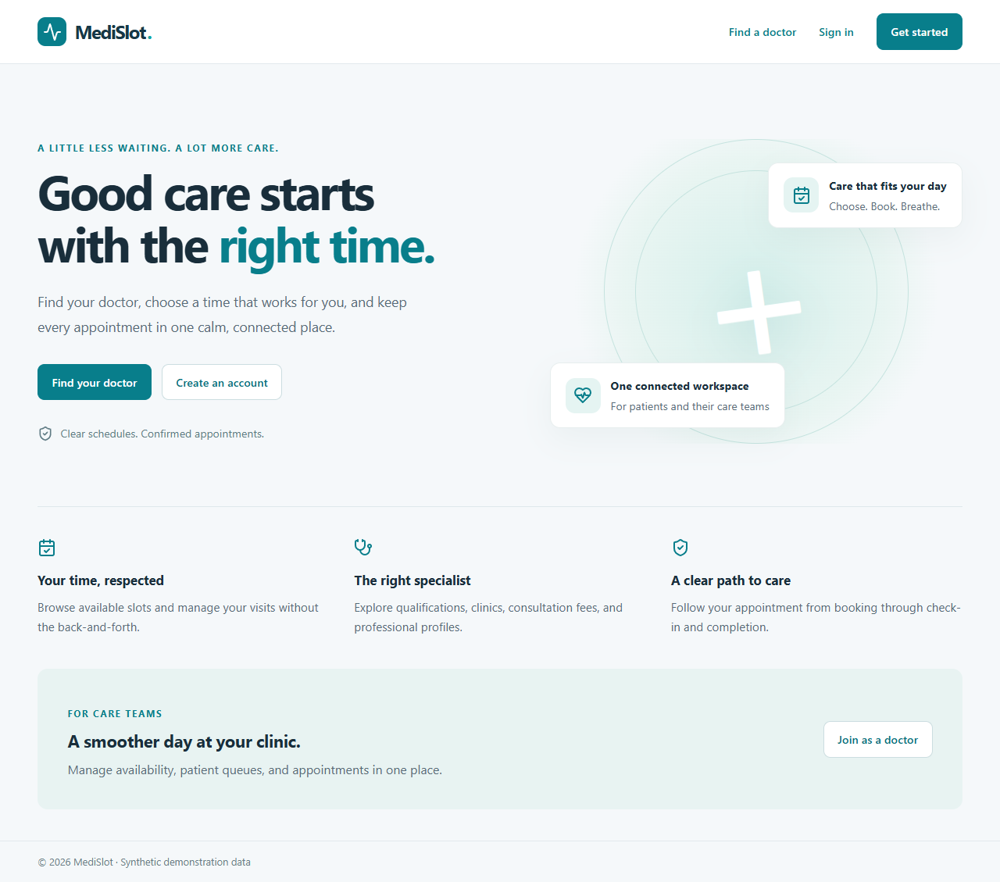
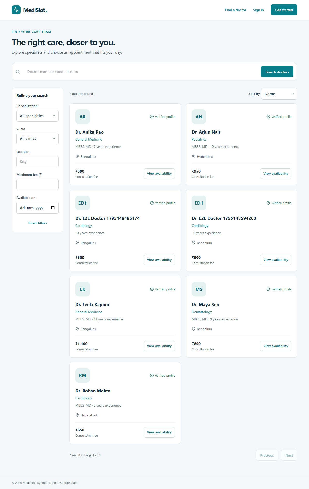
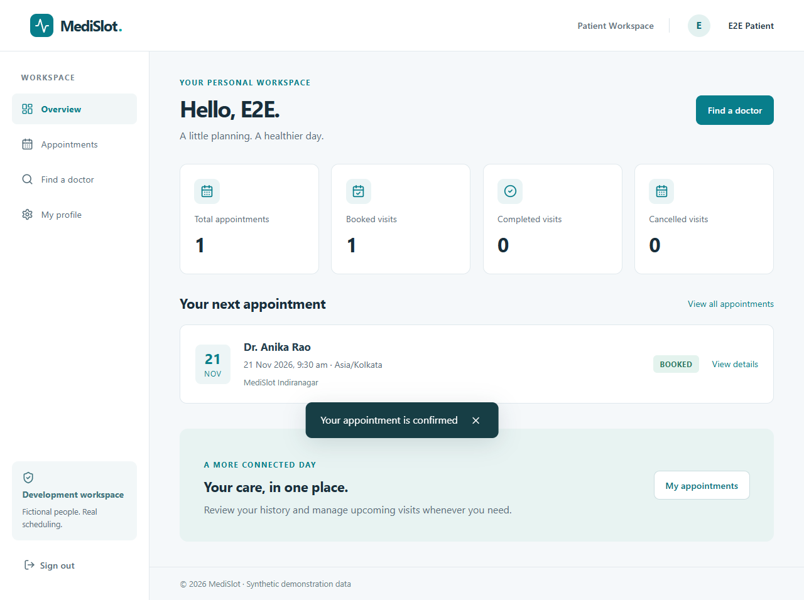
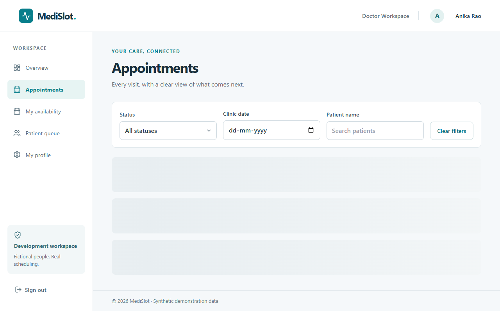
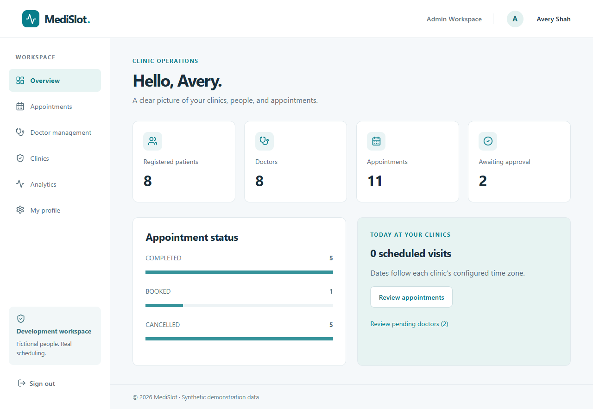
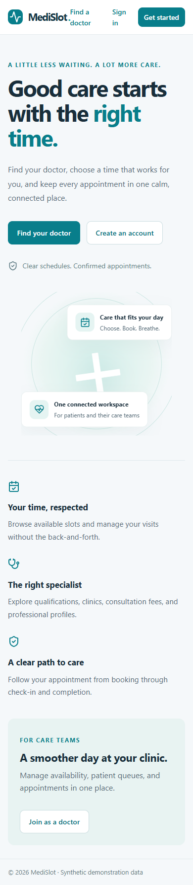
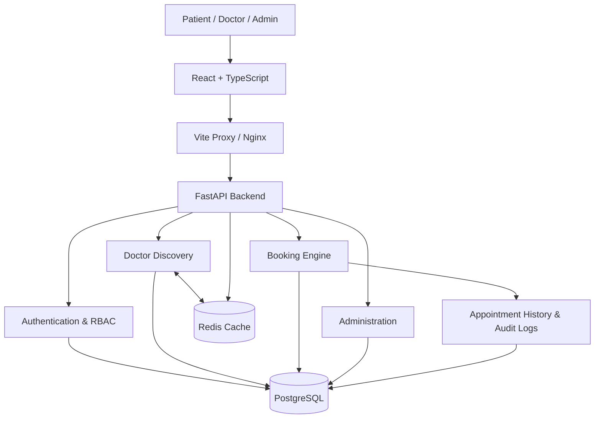
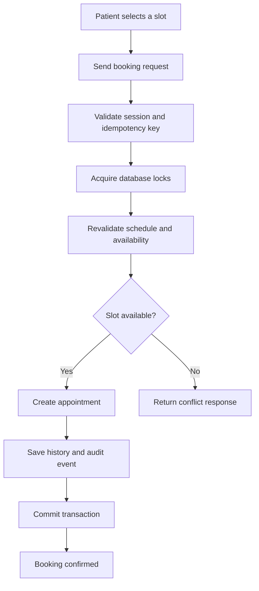

<div align="center">

# 🏥 MediSlot
### Smart Doctor Appointment Booking & Clinic Management System

**A full-stack healthcare scheduling platform engineered for reliable, secure and concurrency-safe appointment management.**

[](https://react.dev/)
[](https://www.typescriptlang.org/)
[](https://fastapi.tiangolo.com/)
[](https://www.postgresql.org/)
[](https://redis.io/)
[](https://www.docker.com/)

[](https://github.com/tejasrs77/medislot-appointment-booking/actions/workflows/ci.yml)

[Features](#-key-features) •
[Screenshots](#-application-preview) •
[Architecture](#-system-architecture) •
[Installation](#-getting-started) •
[Testing](#-testing--quality-assurance)

</div>

---

## 📖 Overview

**MediSlot** is a full-stack doctor appointment booking and clinic management application designed to simplify healthcare scheduling.

The platform provides dedicated experiences for **patients, doctors and administrators**, supporting doctor discovery, real-time availability calculation, appointment booking, schedule management and clinic administration.

Unlike a basic CRUD booking application, MediSlot focuses on backend reliability, transactional consistency, authentication security and concurrent booking correctness.

### 🎯 The Problem

Traditional appointment systems often encounter:

- Double bookings during simultaneous requests
- Outdated or inconsistent appointment availability
- Manual doctor schedule management
- Limited access control between user roles
- Poor appointment tracking and administration
- Performance bottlenecks during repeated searches

### 💡 The Solution

MediSlot addresses these challenges through PostgreSQL-backed transactional booking, Redis caching, secure authentication, role-based workflows and a responsive React interface.

---

## ✨ Key Features

### 👤 Patient Portal

- Secure patient registration and login
- Search doctors by name and specialization
- Filter by clinic, location, fees and availability
- View doctor profiles and available appointment slots
- Book appointments with conflict prevention
- Reschedule or cancel existing appointments
- Track appointment status and history
- View personalized appointment summaries

### 🩺 Doctor Portal

- Dedicated doctor dashboard
- Manage professional profile and consultation details
- Configure weekly availability schedules
- Manage leave and unavailable periods
- View upcoming patient appointments
- Update appointment lifecycle statuses
- Prevent schedule changes that conflict with existing bookings

### 🛡️ Administrator Portal

- Monitor clinic-wide appointment activity
- Review and approve doctor registrations
- Suspend doctor accounts
- Create and update clinics
- Assign doctors to clinics
- View patient, doctor and appointment statistics
- Analyze appointment status distributions and daily activity

---

## 📸 Application Preview

### Landing Page



### Doctor Discovery



### Patient Dashboard



### Doctor Appointment Management



### Admin Dashboard



### Responsive Mobile Interface



---

## 🛠️ Technology Stack

| Layer | Technologies |
|---|---|
| Frontend | React 19, TypeScript, Vite |
| UI | Tailwind CSS, Lucide React |
| State & Forms | TanStack Query, React Hook Form, Zod |
| Backend | Python, FastAPI, Pydantic |
| ORM | SQLAlchemy 2 |
| Database | PostgreSQL 16 |
| Caching | Redis 7 |
| Authentication | JWT, Argon2id, HttpOnly Cookies |
| Migrations | Alembic |
| Containers | Docker, Docker Compose, Nginx |
| Backend Testing | pytest, pytest-cov |
| Frontend Testing | Vitest, React Testing Library |
| E2E Testing | Playwright |
| Performance Testing | Locust, custom benchmarks |
| CI/CD | GitHub Actions |
| Code Quality | Ruff, ESLint, TypeScript |

---

## 🏗️ System Architecture

MediSlot follows a modular full-stack architecture.



### Architecture Highlights

**Frontend:** React and TypeScript provide responsive, role-specific interfaces with API communication and form validation.

**Backend:** FastAPI exposes REST endpoints for authentication, doctor discovery, appointment management and administration.

**Database:** PostgreSQL stores users, doctors, clinics, schedules, appointments, sessions and audit records.

**Caching:** Redis reduces repeated database queries for public doctor discovery and availability requests.

**Deployment:** Docker Compose orchestrates PostgreSQL, Redis, FastAPI and the Nginx-served frontend.

For additional technical details, see [Architecture Documentation](docs/architecture/system.md).

---

## 🔐 Concurrency-Safe Appointment Booking

One of MediSlot's key engineering features is its transactional booking mechanism.

### The Challenge

Consider two patients attempting to book the same doctor at the same time.

Without proper concurrency control, both requests could read the slot as available and create conflicting appointments.

### MediSlot's Approach

The booking service combines:

1. **PostgreSQL transactions** to keep related operations atomic.
2. **Row-level locking** to coordinate concurrent changes.
3. **PostgreSQL exclusion constraints** to prevent overlapping active appointment intervals.
4. **Idempotency keys** to safely handle repeated booking requests.
5. **Server-side validation** of schedules, leave periods and appointment status.
6. **Retry handling** for selected transient database conflicts.

### Booking Workflow



The database exclusion constraint acts as a final integrity safeguard, including when concurrent requests reach different application workers.

**Result:** Overlapping active appointments are rejected at the database level, rather than relying only on frontend availability checks.

---

## 🔒 Authentication & Security

MediSlot implements multiple layers of application security.

- JWT-based authentication
- HttpOnly authentication cookies
- Refresh-token rotation
- Argon2id password hashing
- Role-based access control (RBAC)
- CSRF protection for authenticated mutations
- Origin validation
- Session revocation on logout and password changes
- Rate limiting
- Audit logging
- Restricted API response data
- Configurable secure cookies for HTTPS deployment

### User Roles

| Role | Permissions |
|---|---|
| Patient | Discover doctors, book, cancel and reschedule appointments |
| Doctor | Manage profile, schedule, leave and appointment statuses |
| Admin | Manage clinics, approve doctors and access administrative analytics |

Production deployments require HTTPS, secure cookie configuration and appropriately managed secrets.

---

## ⚡ Performance & Caching

Redis is used to cache frequently accessed public data.

| Cached Data | Cache Duration |
|---|---|
| Doctor discovery and profiles | 30 seconds |
| Appointment availability summaries | 15 seconds |

### Performance Design

- Redis-backed caching for repeated public queries
- Cache invalidation following relevant updates
- PostgreSQL indexes for common filtering patterns
- Pagination for appointment and doctor listings
- Database-level constraints for booking correctness
- Rate limiting for sensitive endpoints
- Load-testing and benchmarking scripts

**Important:** Redis is not the source of truth for bookings. Availability is revalidated against PostgreSQL during appointment creation.

If Redis becomes unavailable, booking correctness continues to depend on PostgreSQL.

---

## 🚀 Getting Started

### Prerequisites

Install:

- Git
- Docker Desktop with Docker Compose
- Python 3.11+ for local configuration

Node.js 22+ and npm are required only for native frontend development.

### 1. Clone the Repository

```bash
git clone https://github.com/tejasrs77/medislot-appointment-booking.git

cd medislot-appointment-booking
```

### 2. Generate Local Configuration

```bash
python scripts/configure.py
```

This creates:

```text
.env
seed-credentials.json
```

The configuration script generates local development secrets and a password for the seeded demonstration accounts.

These files are ignored by Git and should never be committed.

### 3. Start with Docker Compose

```bash
docker compose up --build -d
```

Docker Compose starts:

- PostgreSQL
- Redis
- FastAPI backend
- React frontend served by Nginx

The backend container automatically applies Alembic migrations and initializes synthetic demonstration data.

### 4. Access the Application

| Service | URL |
|---|---|
| Frontend | http://localhost:5174 |
| Backend API | http://localhost:8001 |
| Swagger API Docs | http://localhost:8001/docs |
| Health Check | http://localhost:8001/health |
| Readiness Check | http://localhost:8001/ready |

### 5. Check Container Status

```bash
docker compose ps
```

View logs:

```bash
docker compose logs -f
```

Stop the application:

```bash
docker compose down
```

To also delete persistent database volumes:

```bash
docker compose down -v
```

**Warning:** The `-v` option deletes stored development database data.

---

## 🧪 Demo Accounts

MediSlot seeds fictional users for local demonstration.

| Role | Email |
|---|---|
| Patient | patient@medislot.example.com |
| Doctor | doctor@medislot.example.com |
| Administrator | admin@medislot.example.com |

The password is generated locally and stored in:

```text
seed-credentials.json
```

All seeded accounts, clinicians and clinics are synthetic.

---

## 📡 API Overview

FastAPI automatically generates interactive API documentation through Swagger UI.

### Authentication

| Method | Endpoint | Description |
|---|---|---|
| POST | `/api/v1/auth/register` | Register account |
| POST | `/api/v1/auth/login` | Authenticate user |
| POST | `/api/v1/auth/refresh` | Refresh session |
| POST | `/api/v1/auth/logout` | Sign out |
| GET | `/api/v1/auth/me` | Get current user |
| PATCH | `/api/v1/auth/me` | Update profile |

### Doctors

| Method | Endpoint | Description |
|---|---|---|
| GET | `/api/v1/doctors` | Search doctors |
| GET | `/api/v1/doctors/{id}` | Get doctor profile |
| GET | `/api/v1/doctors/{id}/availability` | Get available slots |
| PUT | `/api/v1/doctors/me/schedule` | Update schedule |
| POST | `/api/v1/doctors/me/leave` | Add leave period |

### Appointments

| Method | Endpoint | Description |
|---|---|---|
| POST | `/api/v1/appointments` | Book appointment |
| GET | `/api/v1/appointments` | List appointments |
| GET | `/api/v1/appointments/summary` | Appointment summary |
| POST | `/api/v1/appointments/{id}/cancel` | Cancel appointment |
| POST | `/api/v1/appointments/{id}/reschedule` | Reschedule |
| POST | `/api/v1/appointments/{id}/status` | Update status |

### Administration

| Method | Endpoint | Description |
|---|---|---|
| GET | `/api/v1/admin/dashboard` | View analytics |
| GET | `/api/v1/admin/doctors` | Manage doctors |
| POST | `/api/v1/admin/doctors/{id}/approve` | Approve doctor |
| POST | `/api/v1/admin/doctors/{id}/suspend` | Suspend doctor |
| POST | `/api/v1/admin/clinics` | Create clinic |

Protected endpoints require appropriate authentication and role permissions.

---

## 🧪 Testing & Quality Assurance

MediSlot includes automated testing across multiple layers.

### Backend Tests

Backend testing uses pytest and pytest-cov.

```bash
cd backend

python -m pip install -e ".[dev]"

python -m pytest --cov=app --cov-report=term-missing
```

The repository contains tests for:

- API functionality
- Business logic
- Authentication and permissions
- Appointment operations
- Concurrent booking behavior

The CI pipeline enforces an 80% backend coverage threshold.

### Frontend Tests

```bash
cd frontend

npm ci

npm run lint
npm run typecheck
npm test
npm run build
```

### End-to-End Testing

Playwright is used for browser-level workflow testing.

```bash
cd frontend

npx playwright install

npm run e2e
```

E2E tests require the appropriate application and test services to be running.

### CI Pipeline

GitHub Actions is configured to run automated checks on pushes and pull requests.

The pipeline includes:

- Backend linting
- Backend tests and coverage enforcement
- Frontend linting
- TypeScript checks
- Frontend unit tests
- Production frontend build

CI configuration: [`.github/workflows/ci.yml`](.github/workflows/ci.yml)

---

## 📁 Project Structure

```text
medislot-appointment-booking/
│
├── backend/
│   ├── app/
│   │   ├── api/
│   │   │   ├── auth.py
│   │   │   ├── doctors.py
│   │   │   ├── appointments.py
│   │   │   └── admin.py
│   │   ├── core/
│   │   ├── services/
│   │   │   ├── booking.py
│   │   │   └── availability.py
│   │   ├── models.py
│   │   ├── schemas.py
│   │   ├── security.py
│   │   ├── cache.py
│   │   └── main.py
│   ├── alembic/
│   ├── tests/
│   ├── Dockerfile
│   └── pyproject.toml
│
├── frontend/
│   ├── src/
│   │   ├── pages/
│   │   ├── components.tsx
│   │   ├── api.ts
│   │   └── main.tsx
│   ├── e2e/
│   ├── tests/
│   ├── Dockerfile
│   └── package.json
│
├── docs/
│   ├── architecture/
│   └── screenshots/
│
├── scripts/
│   ├── configure.py
│   ├── benchmark.py
│   ├── start-local.ps1
│   └── test.ps1
│
├── tests/
│   └── performance/
│
├── .github/
│   └── workflows/
│       └── ci.yml
│
├── docker-compose.yml
├── .env.example
└── README.md
```

---

## 🧠 Engineering Challenges & Solutions

### 1. Preventing Double Bookings

**Challenge:** Multiple patients can attempt to reserve overlapping time slots simultaneously.

**Solution:** Transactional booking with PostgreSQL locking, idempotency handling and database exclusion constraints.

### 2. Maintaining Accurate Availability

**Challenge:** Doctor schedules, leave periods and existing appointments continuously affect available slots.

**Solution:** Server-side slot generation and fresh availability validation before database commits.

### 3. Reducing Repeated Database Queries

**Challenge:** Frequently requested doctor profiles and availability data can generate unnecessary database traffic.

**Solution:** Short-lived Redis caching with invalidation following relevant changes.

### 4. Securing Multiple User Roles

**Challenge:** Patients, doctors and administrators require different levels of access.

**Solution:** Role-based authorization, protected API endpoints, session management and audit events.

### 5. Supporting Reproducible Development

**Challenge:** Full-stack projects require several services and consistent environments.

**Solution:** Docker Compose, automated database migrations, environment configuration scripts and CI workflows.

---

## 📈 Future Improvements

Potential extensions include:

- Email and SMS appointment reminders
- Waitlist management
- Calendar integration
- Teleconsultation support
- Observability dashboards
- Horizontal scaling and distributed performance optimization
- Production deployment with HTTPS and managed infrastructure

These are planned enhancements, not currently implemented features.

---

## ⚠️ Project Scope

MediSlot is a software engineering and portfolio demonstration project.

It uses synthetic development data and does not store real patient medical records, diagnoses or payment information.

It is not represented as a certified medical system or a production-ready healthcare compliance solution.

---

## 👨‍💻 Author

**Tejas RS**

AI & Machine Learning Engineering Student  
Full-Stack Development | Backend Engineering | AI/ML

**GitHub:** [@tejasrs77](https://github.com/tejasrs77)

**Repository:** [MediSlot Appointment Booking](https://github.com/tejasrs77/medislot-appointment-booking)

---

<div align="center">

### ⭐ If you find this project useful, consider starring the repository!

**Built with React, FastAPI, PostgreSQL, Redis and Docker.**

</div>
