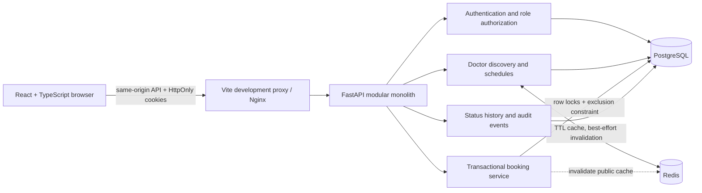
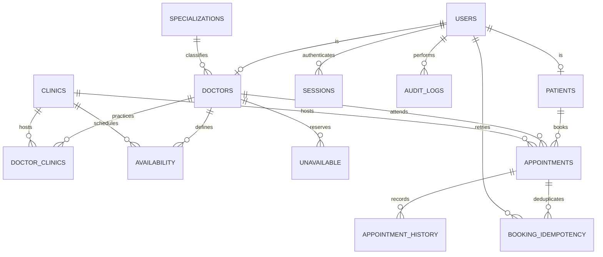

# Architecture

## Entity relationships

There are no clinical records, diagnoses, payment records, external notifications, or real patient data. Appointment views expose names and scheduling information only; they omit account email addresses and passwords.

## Transaction boundaries

Booking takes a transaction-scoped PostgreSQL advisory lock derived from the authenticated patient and idempotency key, then checks the saved fingerprint. It locks the doctor row, validates fresh schedule/leave data, inserts the appointment, idempotency record, status history and audit event, and commits them together. PostgreSQL's GiST exclusion constraint on `(doctor_id, tstzrange(starts_at, ends_at, '[)'))` independently rejects overlapping active intervals. This remains effective for direct database writers and different durations.

The doctor row also serializes schedule and leave changes with booking. Rescheduling locks the doctor before the appointment, changes the interval in one transaction, and retains the original appointment if the target overlaps. Cancellation locks the appointment and records the transition atomically. All status transitions are checked server-side.

Deadlocks and serialization failures during booking receive at most three attempts; other database failures yield a safe service-unavailable response. A client should retry booking with the same idempotency key. Reschedule network retries can safely reapply the same target while the appointment remains BOOKED; rescheduling does not currently expose an optimistic version token for detecting two sequential edits by the same patient.

## Time zones

Stored appointment/leave instants are timezone-aware UTC. Weekly rules are clinic-local minute ranges. Slot generation round-trips wall times through UTC: nonexistent DST times are omitted, repeated wall times produce distinct UTC candidates, and slots crossing a clock change are omitted. Appointment duration is elapsed time. Weekly schedules across different clinic time zones are deliberately rejected to avoid ambiguous cross-clinic working-hour overlap.

## Sessions

Argon2id hashes passwords. Short-lived JWTs are stored in HttpOnly cookies, with an opaque refresh token stored hashed in PostgreSQL. Refresh rotates that token under a row lock. Every authenticated request also checks session revocation and account status, so logout and password changes revoke access immediately. A session has a fixed seven-day maximum lifetime. Mutations require a session-bound CSRF header; browser Origin is checked. JWT verification fixes issuer, audience, and HS256. Local HTTP uses non-Secure cookies; production must set COOKIE_SECURE=true and use TLS.

## Cache consistency and limits

Redis caches discovery/profile results for 30 seconds and availability summaries for 15 seconds. Mutations invalidate public keys after commit. Failed invalidation can leave a display stale until TTL; booking always validates PostgreSQL. Rate limiting uses an atomic Lua increment/expiry and falls back to an in-process limiter when Redis fails. Distributed rate limiting requires Redis; the fallback is per worker. Public cache invalidation currently scans the public namespace and discovery assembles profiles with per-doctor queries; benchmark before scaling these paths, then consider generation keys and batched joins.

## Index rationale

Primary keys, user email, doctor user ID, and idempotency `(user_id,key)` enforce identity. Appointment doctor/patient/clinic/time/status indexes support dashboard filters. GiST enforces interval integrity. Specialization/status indexes support discovery. A lower-name index supports ordered/equality search; `%substring%` search does not use a normal B-tree. If measured search traffic warrants it, evaluate pg_trgm rather than claiming the existing index accelerates arbitrary substrings.
